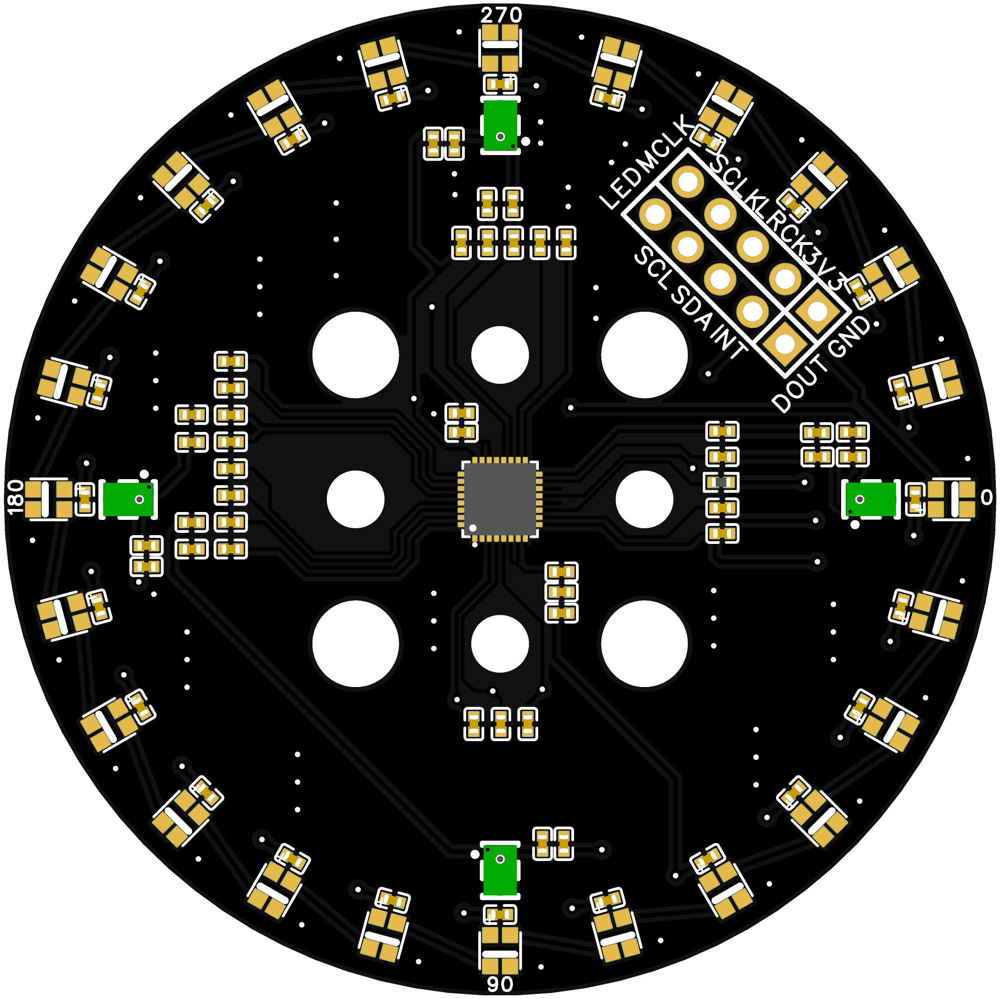

# SoundCompass — Four-Mic Sound Source Localization on ESP32

**English** | [简体中文](README.zh-CN.md)

A four-microphone acoustic direction finder for ESP32, paired with a 24-LED ring that points at the
sound source. The direction estimate is computed on-device with GCC-PHAT, and a WebRTC VAD from
Espressif's `esp-sr` can be enabled so that only human voice moves the light.



The module carries four MEMS microphones at 0°/90°/180°/270°, an ES7210 four-channel ADC and 24
addressable RGB LEDs around the rim. It plugs into any ESP32 board that has I2S TDM through a
2×5 2.54 mm header — seven signal wires plus power and ground.

- [Features](#features)
- [Hardware](#hardware)
- [Requirements](#requirements)
- [Build and flash](#build-and-flash)
- [Run](#run)
- [Configuration](#configuration)
- [Project layout](#project-layout)
- [Component API](#component-api)
- [How it works](#how-it-works)
- [Calibration and troubleshooting](#calibration-and-troubleshooting)
- [Porting to another project](#porting-to-another-project)
- [License](#license)

## Features

- **GCC-PHAT localization** with parabolic interpolation, 4-channel TDM at 48 kHz, 2048-sample frames.
- **`0`–`360°` angle**, LED index, confidence and per-channel level for every accepted frame.
- **Voice-only mode** using the WebRTC GMM VAD from `esp-sr` — no model partition, no extra flash.
- **Four LED effects** (point, trail, breath, comet) with rainbow or solid color.
- **Runtime switching** of both the LED effect and the localization mode; no re-init needed.
- **Three independent components**: capture, localization and LED output can be reused separately.
- **Everything configurable**: `menuconfig` defaults, plus a `*_config_default()` + struct API.

## Hardware

The board is the analog and optical front end; the ESP32 runs the application.

| Item | Detail |
| --- | --- |
| ADC | ES7210, 4 channels, I2C address `0x40` (the driver scans `0x40`–`0x43`) |
| Microphones | 4 × MEMS, 40 mm diagonal spacing, at 0°/90°/180°/270° |
| LEDs | 24 × addressable RGB (WS2812-compatible, GRB order), first LED at 0° |
| Interface | 2×5, 2.54 mm header: I2S, I2C, LED data, 3.3 V and GND |
| Board | Circular PCB with angle markings `0`, `90`, `180`, `270` |

Buy the module on Taobao: <https://item.taobao.com/item.htm?id=1100133001269>

### Module pinout

Silkscreen labels, arranged as two rows of five:

| | 1 | 2 | 3 | 4 | 5 |
| --- | --- | --- | --- | --- | --- |
| **Upper row** | MCLK | SCLK | LRCK | 3V3 | GND |
| **Lower row** | LED | SCL | SDA | INT | DOUT |

| Signal | Direction | Function | Default GPIO (ESP32-S3) |
| --- | --- | --- | --- |
| `MCLK` | ESP32 → module | I2S master clock, 18.432 MHz (384 × fs) | 16 |
| `SCLK` | ESP32 → module | I2S bit clock, 6.144 MHz | 17 |
| `LRCK` | ESP32 → module | I2S word clock / WS, 48 kHz | 18 |
| `DOUT` | module → ESP32 | I2S data from the ES7210 | 15 |
| `SCL` | ESP32 → module | I2C clock for the ES7210 | 5 |
| `SDA` | ESP32 ↔ module | I2C data for the ES7210 | 6 |
| `INT` | module → ESP32 | ES7210 interrupt — not used by this firmware | — |
| `LED` | ESP32 → module | WS2812 data for the 24-LED ring | 4 |
| `3V3` | power | 3.3 V supply | 3V3 |
| `GND` | power | Ground | GND |

The ESP32 is the I2S master: it generates `MCLK`, `SCLK` and `LRCK`, and the ES7210 streams the four
microphone channels on `DOUT`. All GPIO numbers are defaults and can be changed in
`main/main.c` or with `menuconfig`.

> The defaults target ESP32-S3. On other chips, remap the pins first — for example the ESP32-C3 has
> no GPIO15–17 available.

### Microphone and LED layout

```
                MIC2 (270°)
                     |
    MIC4 (180°) -----+----- MIC1 (0°)
                     |
                MIC3 (90°)
```

- MIC1–MIC4 are 40 mm apart on the 0°/180° axis; MIC2–MIC3 are 40 mm apart on the 270°/90° axis.
- LED 1 sits at 0°; the 24 LEDs are spaced 15° apart.
- The silkscreen prints the same `0/90/180/270` marks on the board edge.

## Requirements

- **ESP-IDF v5.5.4** — the version this project was built and tested with. `dependencies.lock`
  pins `espressif/esp-sr` 2.6.2 (the manifest asks for `^2.3.0`).
- **A chip with I2S TDM.** ESP32-S3 is the tested target. ESP32-C3/C5/C6/P4 also have TDM and are
  supported by `esp-sr`; ESP32, ESP32-S2 and ESP32-C2 have no TDM and cannot read the ES7210.
- **Network access on the first build**, so the component manager can fetch `esp-sr`.

`sdkconfig.defaults` sets an 8 MB flash. Change it if your board uses a different size, otherwise
the device may boot-loop on a flash size mismatch.

## Build and flash

```bash
idf.py set-target esp32s3
idf.py build
idf.py -p <PORT> flash monitor
```

`set-target` regenerates `sdkconfig` from `sdkconfig.defaults`, so re-check your pin settings after
switching chips. To build with the VS Code ESP-IDF extension, use the same target and remember to
select the port before flashing.

## Run

Open the monitor at **115200 baud**. The firmware starts the localization task immediately and
prints one line per accepted frame:

```
I (271) audio_in: ES7210 @0x40, gain 30dB, readback reg00=0x41 reg11=0x60
I (289) sound_loc: init: fs=48000 frame=2048 max_lag=7 leds=24 spacing=0.040m
I (289) app: ready(fix2): SCL=5 SDA=6 MCLK=16 BCLK=17 WS=18 DIN=15 LED=4 x24
I (289) app: 按键 1~5 切灯效，q/w/e/r 切定位模式
I (1024) app: angle= 88.3 LED06 conf=0.71 voice db=-31/-42/-28/-45
```

The last line is `angle`, `LED index`, `confidence`, `voice`/`sound`, then the four channel levels in
dBFS.

### Serial keys

Type the character directly in the monitor; no line ending is needed.

| Key | LED effect | Key | Localization mode |
| --- | --- | --- | --- |
| `1` | `POINT` — only the target LED, snappy | `q` | `TRACK` — update every frame |
| `2` | `TRAIL` — fading trail behind the source | `w` | `PEAK` — update on energy peaks only |
| `3` | `BREATH` — target LED breathes 15–100% | `e` | `VOICE` — only human voice counts |
| `4` | `COMET` — head slides to the source | `r` | `OFF` — pause localization |
| `5` | `OFF` — all LEDs off | | |

LED effect and localization mode are independent: `VOICE` + `COMET` means "follow human voice only,
display it as a comet".

## Configuration

The application overrides a few values in the macro block at the top of `main/main.c`; everything
else falls back to the Kconfig defaults filled in by `*_config_default()`.

| Macro | Value | Meaning |
| --- | --- | --- |
| `PIN_I2C_SCL` / `PIN_I2C_SDA` | 5 / 6 | ES7210 I2C |
| `PIN_I2S_MCLK` / `PIN_I2S_BCLK` / `PIN_I2S_WS` / `PIN_I2S_DIN` | 16 / 17 / 18 / 15 | I2S TDM |
| `PIN_LED` | 4 | WS2812 data |
| `LED_COUNT` | 24 | LEDs on the ring |
| `MIC_SPACING_MM` | 40 | Diagonal microphone spacing |
| `MIC_GAIN_DB` | 30 | ES7210 gain, 0–42 dB in 3 dB steps |
| `ANGLE_OFFSET_DEG` | 0 | Angle calibration, positive = clockwise |
| `ANGLE_CLOCKWISE` | 0 (mirrored) | Flip if the LED moves opposite to the sound |
| `MIN_CONFIDENCE` | 0.15 | Lower = more sensitive, more jitter |
| `VOICE_MIN_DB` | -52 | Level gate; must stay above the noise floor |
| `TRAIL_DECAY_MS` | 1000 | Trail decay time |
| `LED_IDLE_MS` | 500 | Turn off after this much silence |
| `TRAIL_LEN` | 3 | Trail length in LEDs |
| `MIC_CH1` … `MIC_CH4` | 0, 1, 2, 3 | Logical MIC1–4 → physical channel |

Several values intentionally differ from the Kconfig defaults to match the shipped module:
`min_confidence` 0.15 instead of 0.35, `clockwise = false` instead of `y`, `voice_min_db` -52
instead of -40, and the trail/idle timings (1000 ms decay, 500 ms auto-off, 3 LEDs) instead of
450 ms / 1200 ms / 6 LEDs.

### menuconfig

| Menu | Option | Default |
| --- | --- | --- |
| Audio in ES7210 | I2C SCL / SDA GPIO | 5 / 6 |
| Audio in ES7210 | I2S port number | 0 |
| Audio in ES7210 | I2S MCLK / BCLK / WS / DIN GPIO | 16 / 17 / 18 / 15 |
| Audio in ES7210 | Microphone gain (dB) | 30 |
| LED ring effects | WS2812 data GPIO / LED count | 4 / 24 |
| LED ring effects | Color R/G/B, max brightness | 0/0/255, 255 |
| LED ring effects | LED data order is GRB | y |
| LED ring effects | Trail length / decay / auto-off | 6 / 450 ms / 1200 ms |
| Sound localizer | Diagonal mic spacing (mm) | 40 |
| Sound localizer | Angle offset / clockwise | 0 / y |
| Sound localizer | Voice level / flatness / confidence | -40 dB / 0.45 / 0.35 |

## Project layout

```
SoundCompass/
├── CMakeLists.txt              top-level project
├── sdkconfig.defaults          target and 8 MB flash
├── main/
│   ├── CMakeLists.txt
│   └── main.c                  pin map, mode switching, serial keys
├── components/
│   ├── audio_in_es7210/        I2C scan + ES7210 setup + I2S TDM read
│   ├── sound_localizer/        GCC-PHAT → angle → confidence → VAD
│   └── led_ring_fx/            POINT / TRAIL / BREATH / COMET
└── docs/images/
```

The three components are independent: `led_ring_fx` knows nothing about audio, and
`sound_localizer` only needs the `audio_in_es7210` handle type. `sound_localizer` declares
`espressif/esp-sr` in `idf_component.yml`, so the component manager downloads it on the first build.

## Component API

### Quick reference

| Task | Call |
| --- | --- |
| Change LED effect | `lrfx_set_mode(LRFX_TRAIL)` |
| LED color: rainbow / solid | `lrfx_set_color_mode(LRFX_COLOR_RAINBOW)` / `LRFX_COLOR_SOLID` |
| Set solid color (switches to solid) | `lrfx_set_color(0, 0, 255)` |
| Light one LED, 0–1 intensity | `lrfx_set_target(led_index, 0.8f)` |
| Turn everything off | `lrfx_clear()` |
| Voice-only localization | `sl_set_mode(SL_MODE_VOICE)` |
| Localize any loud sound | `sl_set_mode(SL_MODE_TRACK)` |
| Peak-triggered localization | `sl_set_mode(SL_MODE_PEAK)` |
| Pause processing | `sl_set_mode(SL_MODE_OFF)` |
| Stop / restart the task | `sl_stop()` / `sl_start(on_sound, NULL)` |
| Read the latest result | `sl_get_result(&r)` |
| Angle only (`NAN` if none) | `sl_get_angle()` |
| LED index only (`-1` if none) | `sl_get_led_index()` |

### audio_in_es7210

```c
#include "audio_in_es7210.h"

audio_in_config_t cfg;
audio_in_config_default(&cfg);          // pins and gain from menuconfig
cfg.scl_gpio = 5;
cfg.sda_gpio = 6;

audio_in_handle_t audio;
ESP_ERROR_CHECK(audio_in_init(&cfg, &audio));

int16_t buf[2048 * AUDIO_IN_CHANNELS];  // 4 channels interleaved
ESP_ERROR_CHECK(audio_in_read(audio, buf, 2048, 1000));

audio_in_deinit(audio);
```

| Function | Description |
| --- | --- |
| `audio_in_config_default(cfg)` | Fill the config from Kconfig |
| `audio_in_init(cfg, &handle)` | Create I2C, probe/configure the ES7210, start I2S TDM |
| `audio_in_read(h, dst, frames, timeout_ms)` | Blocking read of `frames` frames, interleaved `int16` |
| `audio_in_deinit(h)` | Release I2S and I2C |

The output format is 4-channel interleaved `int16`; gain is written in 3 dB steps. MCLK is fixed at
384 × fs because 48 kHz × 4 slots × 32 bit needs a clock at least 3 × BCLK — otherwise the I2S driver
warns and changes the divider, and the ES7210 falls out of sync.

### sound_localizer

```c
#include "sound_localizer.h"

sl_config_t cfg;
sl_config_default(&cfg);
cfg.led_count = 24;

ESP_ERROR_CHECK(sl_init(&cfg, audio));
ESP_ERROR_CHECK(sl_start(on_sound, NULL));
```

| Function | Description |
| --- | --- |
| `sl_config_default(cfg)` | Fill the config from Kconfig |
| `sl_init(cfg, audio)` | Allocate buffers, precompute the window, validate the frame length |
| `sl_start(cb, user)` | Start the localization task; `cb` runs once per accepted frame |
| `sl_stop()` | Delete the task; `sl_start()` can bring it back |
| `sl_set_mode(mode)` / `sl_get_mode()` | Switch / read the localization mode |
| `sl_get_result(&r)` | Non-blocking snapshot of the latest result |
| `sl_get_angle()` | `0`–`360`, or `NAN` when there is no valid result |
| `sl_get_led_index()` | LED index, or `-1` when there is no valid result |

Callback prototype — runs in the localization task, so keep it short:

```c
static void on_sound(const sl_result_t *r, void *user)
{
    // r->angle_deg    0-360
    // r->led_index    0 .. led_count-1
    // r->confidence   0-1; frames below min_confidence never reach this callback
    // r->level_db[4]  per-channel level
    // r->is_voice     true when the VAD accepted this frame
    lrfx_set_target(r->led_index, 0.8f);
}
```

| Mode | Behavior |
| --- | --- |
| `SL_MODE_TRACK` | Update every frame; fastest, slightly jittery |
| `SL_MODE_PEAK` | Update only on local energy peaks; steadier, about one frame of latency |
| `SL_MODE_VOICE` | Only human voice triggers an update |
| `SL_MODE_OFF` | Stop processing to save CPU |

| Config field | Default | Description |
| --- | --- | --- |
| `sample_rate` | 48000 | Must match the capture rate |
| `mic_spacing_m` | 0.04 | Diagonal microphone spacing |
| `speed_of_sound` | 343 | m/s |
| `angle_offset_deg` | 0 | Installation calibration |
| `clockwise` | true | Angle direction |
| `mic_map[4]` | {0,1,2,3} | Logical MIC1–4 → physical channel |
| `frame_len` | 2048 | Power of two, 256–4096 |
| `led_count` | 24 | Number of LEDs to map onto |
| `voice_min_db` | -40 | Level gate for voice frames |
| `voice_flatness_max` | 0.45 | Logging only; the VAD decides voice |
| `min_confidence` | 0.35 | Minimum GCC-PHAT confidence |

Voice detection uses the **WebRTC GMM VAD** shipped with `espressif/esp-sr`:

- MIC1 is decimated from 48 kHz to **16 kHz** by 3:1 averaging and fed to `vad_process()` in
  **30 ms** frames.
- Default parameters are `VAD_MODE_0`, `min_speech_ms = 200`, `min_noise_ms = 100`, set where
  `vad_create_with_param()` is called.
- No model partition or extra flash is required.
- If speech is missed, lower `min_speech_ms`; if noise triggers it, try `VAD_MODE_2`.
- The VAD is fixed at 16 kHz, so `sample_rate` must stay at 48 kHz for `is_voice` to work.

### led_ring_fx

```c
#include "led_ring_fx.h"

lrfx_config_t fx;
lrfx_config_default(&fx);
fx.mode = LRFX_TRAIL;
ESP_ERROR_CHECK(lrfx_init(&fx));

lrfx_set_target(6, 0.8f);   // LED 6 at 80 %
lrfx_set_mode(LRFX_COMET);
```

| Function | Description |
| --- | --- |
| `lrfx_config_default(cfg)` | Fill the config from Kconfig |
| `lrfx_init(cfg)` / `lrfx_deinit()` | Start / stop the 25 ms refresh task and RMT channel |
| `lrfx_set_mode(mode)` / `lrfx_get_mode()` | Switch / read the effect |
| `lrfx_set_target(led, intensity)` | Set target LED, intensity 0–1 |
| `lrfx_clear()` | Turn all LEDs off |
| `lrfx_set_color_mode(mode)` / `lrfx_get_color_mode()` | Rainbow or solid |
| `lrfx_set_color(r, g, b)` | Set the solid color and switch to solid mode |

| Effect | Behavior | Key parameters |
| --- | --- | --- |
| `LRFX_POINT` | Only the target LED, sharp switching | 40 ms decay + 120 ms hold |
| `LRFX_TRAIL` | Keeps the last `trail_len` LEDs, dimmer with distance | `decay_ms`, `trail_len` |
| `LRFX_BREATH` | Target LED breathes between 15 % and 100 % | 1.0 s period |
| `LRFX_COMET` | Head moves at ~120 LEDs/s, tail fades | `decay_ms` |
| `LRFX_OFF` | All off | — |

| Config field | Description |
| --- | --- |
| `color_mode` | `LRFX_COLOR_RAINBOW` (default) or `LRFX_COLOR_SOLID` |
| `r` / `g` / `b` | Solid-mode color; ignored in rainbow mode |
| `grb_order` | Most WS2812s are GRB — change this first if colors look wrong |
| `trail_len` | Target LED plus recent LEDs; retracts after 3 × `decay_ms` |
| `decay_ms` | Exponential decay time constant |
| `idle_timeout_ms` | Turn off after this idle time; 0 disables |

### Putting it together

```c
static void on_sound(const sl_result_t *r, void *user)
{
    float lvl = (r->max_level_db + 60.0f) / 40.0f;   // -60..-20 dBFS -> 0..1
    if (lvl < 0.15f) lvl = 0.15f;
    if (lvl > 1.0f) lvl = 1.0f;
    lrfx_set_target(r->led_index, lvl);
}

void app_main(void)
{
    audio_in_config_t acfg;
    audio_in_config_default(&acfg);
    audio_in_handle_t audio;
    audio_in_init(&acfg, &audio);

    lrfx_config_t fcfg;
    lrfx_config_default(&fcfg);
    lrfx_init(&fcfg);

    sl_config_t scfg;
    sl_config_default(&scfg);
    scfg.led_count = fcfg.led_count;
    sl_init(&scfg, audio);
    sl_start(on_sound, NULL);
}
```

## How it works

1. **Frame** — 2048 samples at 48 kHz (43 ms), Hann window.
2. **GCC-PHAT** — per-channel FFT, cross-spectrum divided by its magnitude (whitening, which
   suppresses reverberation and low-frequency dominance), inverse FFT.
3. **Peak search** — find the maximum inside the physically possible delay range, then interpolate
   with a parabola for sub-sample precision.
4. **Angle** — `cosθ = c·τ14/(d·fs)` from the MIC4–MIC1 delay and `sinθ = c·τ23/(d·fs)` from the
   MIC2–MIC3 delay, then `θ = atan2(sinθ, cosθ)`.
5. **Smoothing** — circular exponential smoothing on `(cosθ, sinθ)` avoids jumps at 0°.
6. **LED mapping** — `led = round(θ / (360/led_count)) % led_count`.

With 40 mm spacing at 48 kHz the largest delay is only ~5.6 samples, so the sample rate should not
be lowered (at 16 kHz it would be ~1.9 samples) and the sub-sample interpolation must stay enabled.

## Calibration and troubleshooting

**The light moves the wrong way.** The sound rotates clockwise but the LED walks counter-clockwise:
set `ANGLE_CLOCKWISE` to `1`, or `sl_cfg.clockwise = !sl_cfg.clockwise`. If it is off by a constant
angle instead, use `ANGLE_OFFSET_DEG`.

**Channel order is wrong.** If the physical channels differ from the silkscreen, remap them without
touching the algorithm:

```c
sl_cfg.mic_map[0] = 1;   // logical MIC1 is on physical channel 1
```

**LEDs stay dark or show wrong colors.** Check the data wire on `LED` (GPIO4). If red and green are
swapped, change `grb_order`.

**Angle jumps and confidence is low.** Watch `conf` in the log; frames below `min_confidence` are
dropped. Try `SL_MODE_PEAK` in noisy rooms, and lower the gain from 30 dB to 24 dB if the capsules
clip.

**Boot loop right after flashing.** Check the flash size in `sdkconfig.defaults` against the real
part; the project defaults to 8 MB.

**No voice detection.** Keep `sample_rate = 48000`; at any other rate `is_voice` stays `false` and
`SL_MODE_VOICE` never fires.

## Porting to another project

1. Copy the three directories under `components/` into your project. Keep
   `sound_localizer/idf_component.yml` — it declares the `esp-sr` dependency.
2. Declare the components in `main/CMakeLists.txt`:

```cmake
idf_component_register(SRCS "main.c" INCLUDE_DIRS "."
    REQUIRES audio_in_es7210 sound_localizer led_ring_fx)
```

3. Change pins, `mic_spacing_m` and `led_count` for your hardware.

Internal dependencies:

- `audio_in_es7210` → `esp_driver_i2c`, `esp_driver_i2s`
- `sound_localizer` → `audio_in_es7210`, `esp_timer`, `esp-sr`
- `led_ring_fx` → `esp_driver_rmt`, `esp_timer`

## License

This project is released under the [MIT License](LICENSE).

The localization pipeline and the ESP32 integration code are original work. Voice activity detection
comes from [Espressif `esp-sr`](https://github.com/espressif/esp-sr) (Apache-2.0), pulled in by the
component manager, and the VAD keeps its original license.

The Arduino port of this project, with a precompiled localization core, lives in a separate
repository.
