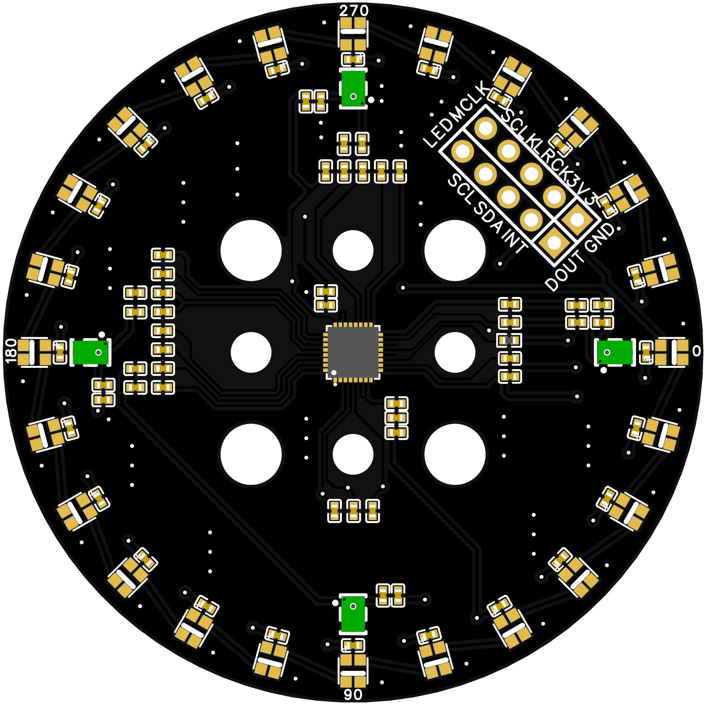

# SoundCompass — 基于 ESP32 的四麦声源定位

[English](README.md) | **简体中文**

面向 ESP32 的四麦克风声源方向识别方案，配合 24 颗环形灯珠，把声源方向直接"指"出来。
方向由 GCC-PHAT 在片上计算，也可以启用 Espressif `esp-sr` 的 WebRTC VAD，只让人声驱动灯环。



模块在 0°/90°/180°/270° 四个方位布置了 MEMS 麦克风，中央是 ES7210 四通道 ADC，外圈是
24 颗可寻址 RGB 灯珠。通过一个 2×5、2.54 mm 排针接到任意支持 I2S TDM 的 ESP32 板：
七根信号线，加电源和地。

- [功能特点](#功能特点)
- [硬件](#硬件)
- [环境要求](#环境要求)
- [编译与烧录](#编译与烧录)
- [运行](#运行)
- [配置](#配置)
- [目录结构](#目录结构)
- [组件 API](#组件-api)
- [定位原理](#定位原理)
- [校准与排查](#校准与排查)
- [移植到其他工程](#移植到其他工程)
- [许可证](#许可证)

## 功能特点

- **GCC-PHAT 定位**：抛物线插值，48 kHz、4 通道 TDM，2048 点分帧。
- **完整结果**：每个有效帧输出 `0`–`360°` 角度、灯珠序号、置信度和四通道电平。
- **仅人声模式**：使用 `esp-sr` 的 WebRTC GMM VAD，不需要 model 分区，不额外占用 Flash。
- **四种灯效**：单点、拖尾、呼吸、彗星，支持彩虹渐变或单色。
- **运行中切换**：灯效和定位模式都能随时切换，不需要重新初始化。
- **三个独立组件**：采集、定位、灯效可以分别复用。
- **配置齐全**：`menuconfig` 默认值，加上 `*_config_default()` + 结构体的 API。

## 硬件

模块负责模拟采集和灯环显示，应用程序跑在 ESP32 上。

| 项目 | 说明 |
| --- | --- |
| ADC | ES7210，4 通道，I2C 地址 `0x40`（驱动会扫描 `0x40`–`0x43`） |
| 麦克风 | 4 颗 MEMS，对角间距 40 mm，位于 0°/90°/180°/270° |
| 灯珠 | 24 颗可寻址 RGB（兼容 WS2812，GRB 顺序），第 1 颗在 0° |
| 接口 | 2×5、2.54 mm 排针：I2S、I2C、灯珠数据、3.3 V 与 GND |
| 板型 | 圆形 PCB，板边丝印 `0`、`90`、`180`、`270` |

购买链接（淘宝）：<https://item.taobao.com/item.htm?id=1100133001269>

### 模块引脚

按丝印标注，排针为两排五列：

| | 1 | 2 | 3 | 4 | 5 |
| --- | --- | --- | --- | --- | --- |
| **上排** | MCLK | SCLK | LRCK | 3V3 | GND |
| **下排** | LED | SCL | SDA | INT | DOUT |

| 信号 | 方向 | 作用 | 默认 GPIO（ESP32-S3） |
| --- | --- | --- | --- |
| `MCLK` | ESP32 → 模块 | I2S 主时钟，18.432 MHz（384 × fs） | 16 |
| `SCLK` | ESP32 → 模块 | I2S 位时钟，6.144 MHz | 17 |
| `LRCK` | ESP32 → 模块 | I2S 帧时钟 / WS，48 kHz | 18 |
| `DOUT` | 模块 → ESP32 | ES7210 的 I2S 数据 | 15 |
| `SCL` | ESP32 → 模块 | ES7210 的 I2C 时钟 | 5 |
| `SDA` | ESP32 ↔ 模块 | ES7210 的 I2C 数据 | 6 |
| `INT` | 模块 → ESP32 | ES7210 中断 — 本固件未使用 | — |
| `LED` | ESP32 → 模块 | 24 颗灯珠的 WS2812 数据 | 4 |
| `3V3` | 电源 | 3.3 V 供电 | 3V3 |
| `GND` | 电源 | 地 | GND |

ESP32 是 I2S 主机：它产生 `MCLK`、`SCLK` 和 `LRCK`，ES7210 通过 `DOUT` 输出四路麦克风数据。
以上 GPIO 都是默认值，可在 `main/main.c` 或 `menuconfig` 中修改。

> 默认引脚面向 ESP32-S3。换其他芯片前请先改引脚，例如 ESP32-C3 没有可用的 GPIO15–17。

### 麦克风与灯珠布局

```
                MIC2 (270°)
                     |
    MIC4 (180°) -----+----- MIC1 (0°)
                     |
                MIC3 (90°)
```

- MIC1–MIC4 位于 0°/180° 轴上，间距 40 mm；MIC2–MIC3 位于 270°/90° 轴上，间距 40 mm。
- 第 1 颗灯在 0°，24 颗灯每颗间隔 15°。
- 板边丝印与上图使用相同的 `0/90/180/270` 方位标记。

## 环境要求

- **ESP-IDF v5.5.4** — 本工程的开发和验证版本。`dependencies.lock` 锁定
  `espressif/esp-sr` 2.6.2（清单中要求 `^2.3.0`）。
- **支持 I2S TDM 的芯片。** 已验证目标是 ESP32-S3。ESP32-C3/C5/C6/P4 也有 TDM，
  且 `esp-sr` 提供对应支持；ESP32、ESP32-S2、ESP32-C2 没有 TDM，无法读取 ES7210。
- **首次编译需要联网**，由组件管理器下载 `esp-sr`。

`sdkconfig.defaults` 按 8 MB Flash 配置。如果实际板子容量不同请修改，否则可能因为 Flash
容量不匹配而反复重启。

## 编译与烧录

```bash
idf.py set-target esp32s3
idf.py build
idf.py -p <PORT> flash monitor
```

`set-target` 会根据 `sdkconfig.defaults` 重新生成 `sdkconfig`，换芯片后请重新确认引脚设置。
使用 VS Code 的 ESP-IDF 插件时选择同样的目标，烧录前记得选好串口。

## 运行

以 **115200** 波特率打开串口监视器。固件启动后立即开始定位，每个有效帧打印一行：

```
I (271) audio_in: ES7210 @0x40, gain 30dB, readback reg00=0x41 reg11=0x60
I (289) sound_loc: init: fs=48000 frame=2048 max_lag=7 leds=24 spacing=0.040m
I (289) app: ready(fix2): SCL=5 SDA=6 MCLK=16 BCLK=17 WS=18 DIN=15 LED=4 x24
I (289) app: 按键 1~5 切灯效，q/w/e/r 切定位模式
I (1024) app: angle= 88.3 LED06 conf=0.71 voice db=-31/-42/-28/-45
```

最后一行的字段依次是：角度、灯珠序号、置信度、`voice`/`sound`，以及四通道电平（dBFS）。

### 串口按键

在监视器里直接敲字符即可，不需要回车。

| 按键 | 灯效 | 按键 | 定位模式 |
| --- | --- | --- | --- |
| `1` | `POINT` — 只亮目标灯，最跟手 | `q` | `TRACK` — 每帧更新 |
| `2` | `TRAIL` — 声源移动后留下渐隐拖尾 | `w` | `PEAK` — 仅能量峰值帧更新 |
| `3` | `BREATH` — 目标灯 15–100% 呼吸 | `e` | `VOICE` — 仅人声触发 |
| `4` | `COMET` — 亮点滑向声源，带渐隐尾 | `r` | `OFF` — 暂停定位 |
| `5` | `OFF` — 全部熄灭 | | |

灯效与定位模式相互独立：`VOICE` + `COMET` 表示"只跟随人声，用彗星效果显示"。

## 配置

应用层在 `main/main.c` 顶部的宏定义里覆盖了部分参数，其余取 Kconfig 默认值（由
`*_config_default()` 填入）。

| 宏 | 取值 | 含义 |
| --- | --- | --- |
| `PIN_I2C_SCL` / `PIN_I2C_SDA` | 5 / 6 | ES7210 的 I2C |
| `PIN_I2S_MCLK` / `PIN_I2S_BCLK` / `PIN_I2S_WS` / `PIN_I2S_DIN` | 16 / 17 / 18 / 15 | I2S TDM |
| `PIN_LED` | 4 | WS2812 数据 |
| `LED_COUNT` | 24 | 灯珠数量 |
| `MIC_SPACING_MM` | 40 | 对角麦克风间距 |
| `MIC_GAIN_DB` | 30 | ES7210 增益，0–42 dB，3 dB 步进 |
| `ANGLE_OFFSET_DEG` | 0 | 角度校准，正值顺时针 |
| `ANGLE_CLOCKWISE` | 0（镜像） | 灯光与声源方向相反时翻转 |
| `MIN_CONFIDENCE` | 0.15 | 越低越灵敏，抖动也越大 |
| `VOICE_MIN_DB` | -52 | 电平门限，必须高于环境底噪 |
| `TRAIL_DECAY_MS` | 1000 | 拖尾衰减时间 |
| `LED_IDLE_MS` | 500 | 无声多久后熄灭 |
| `TRAIL_LEN` | 3 | 拖尾长度（灯珠数） |
| `MIC_CH1` … `MIC_CH4` | 0, 1, 2, 3 | 逻辑 MIC1–4 → 物理通道 |

有若干值有意不同于 Kconfig 默认值，以匹配出货模块：`min_confidence` 用 0.15（默认 0.35）、
`clockwise = false`（默认 `y`）、`voice_min_db` 用 -52（默认 -40），拖尾和熄灭时间也分别改为
1000 ms 衰减、500 ms 熄灭、3 颗灯（默认 450 ms / 1200 ms / 6 颗）。

### menuconfig

| 菜单 | 配置项 | 默认值 |
| --- | --- | --- |
| Audio in ES7210 | I2C SCL / SDA GPIO | 5 / 6 |
| Audio in ES7210 | I2S port number | 0 |
| Audio in ES7210 | I2S MCLK / BCLK / WS / DIN GPIO | 16 / 17 / 18 / 15 |
| Audio in ES7210 | Microphone gain (dB) | 30 |
| LED ring effects | WS2812 data GPIO / LED count | 4 / 24 |
| LED ring effects | Color R/G/B、最大亮度 | 0/0/255、255 |
| LED ring effects | LED data order is GRB | y |
| LED ring effects | 拖尾长度 / 衰减 / 自动熄灭 | 6 / 450 ms / 1200 ms |
| Sound localizer | 对角麦克风间距 (mm) | 40 |
| Sound localizer | 角度补偿 / 顺时针 | 0 / y |
| Sound localizer | 人声电平 / 谱平坦度 / 置信度 | -40 dB / 0.45 / 0.35 |

## 目录结构

```
SoundCompass/
├── CMakeLists.txt              顶层工程
├── sdkconfig.defaults          目标芯片与 8 MB Flash
├── main/
│   ├── CMakeLists.txt
│   └── main.c                  引脚、模式切换、串口按键
├── components/
│   ├── audio_in_es7210/        I2C 扫描 + ES7210 配置 + I2S TDM 读取
│   ├── sound_localizer/        GCC-PHAT → 角度 → 置信度 → VAD
│   └── led_ring_fx/            POINT / TRAIL / BREATH / COMET
└── docs/images/
```

三个组件互不依赖：`led_ring_fx` 不涉及音频，`sound_localizer` 只需要 `audio_in_es7210` 的
句柄类型。`sound_localizer` 在 `idf_component.yml` 中声明 `espressif/esp-sr`，首次编译时由
组件管理器自动下载。

## 组件 API

### 常用操作速查

| 想做的事 | 调用 |
| --- | --- |
| 切换灯效 | `lrfx_set_mode(LRFX_TRAIL)` |
| 配色：彩虹 / 单色 | `lrfx_set_color_mode(LRFX_COLOR_RAINBOW)` / `LRFX_COLOR_SOLID` |
| 设置单色（自动切单色） | `lrfx_set_color(0, 0, 255)` |
| 点亮某颗灯，强度 0–1 | `lrfx_set_target(led_index, 0.8f)` |
| 全部熄灭 | `lrfx_clear()` |
| 仅人声定位 | `sl_set_mode(SL_MODE_VOICE)` |
| 任意够响的声音都定位 | `sl_set_mode(SL_MODE_TRACK)` |
| 峰值触发定位 | `sl_set_mode(SL_MODE_PEAK)` |
| 暂停处理 | `sl_set_mode(SL_MODE_OFF)` |
| 停止 / 重启任务 | `sl_stop()` / `sl_start(on_sound, NULL)` |
| 读取最近一次结果 | `sl_get_result(&r)` |
| 只取角度（无结果 `NAN`） | `sl_get_angle()` |
| 只取灯珠序号（无结果 `-1`） | `sl_get_led_index()` |

### audio_in_es7210

```c
#include "audio_in_es7210.h"

audio_in_config_t cfg;
audio_in_config_default(&cfg);          // 引脚与增益取自 menuconfig
cfg.scl_gpio = 5;
cfg.sda_gpio = 6;

audio_in_handle_t audio;
ESP_ERROR_CHECK(audio_in_init(&cfg, &audio));

int16_t buf[2048 * AUDIO_IN_CHANNELS];  // 4 通道交错
ESP_ERROR_CHECK(audio_in_read(audio, buf, 2048, 1000));

audio_in_deinit(audio);
```

| 函数 | 说明 |
| --- | --- |
| `audio_in_config_default(cfg)` | 用 Kconfig 默认值填充配置 |
| `audio_in_init(cfg, &handle)` | 建 I2C、探测并配置 ES7210、启动 I2S TDM |
| `audio_in_read(h, dst, frames, timeout_ms)` | 阻塞读取 `frames` 帧，输出交错 `int16` |
| `audio_in_deinit(h)` | 释放 I2S 与 I2C |

输出为 4 通道交错 `int16`，增益按 3 dB 步进写入。MCLK 固定为 384 × fs：48 kHz × 4 槽 ×
32 bit 要求时钟至少为 3 × BCLK，否则 I2S 驱动会告警并改动分频，导致与 ES7210 失配。

### sound_localizer

```c
#include "sound_localizer.h"

sl_config_t cfg;
sl_config_default(&cfg);
cfg.led_count = 24;

ESP_ERROR_CHECK(sl_init(&cfg, audio));
ESP_ERROR_CHECK(sl_start(on_sound, NULL));
```

| 函数 | 说明 |
| --- | --- |
| `sl_config_default(cfg)` | 用 Kconfig 默认值填充配置 |
| `sl_init(cfg, audio)` | 分配缓冲、预计算窗函数、校验帧长 |
| `sl_start(cb, user)` | 启动定位任务，每个有效帧回调一次 `cb` |
| `sl_stop()` | 删除任务，可再用 `sl_start()` 恢复 |
| `sl_set_mode(mode)` / `sl_get_mode()` | 切换 / 读取定位模式 |
| `sl_get_result(&r)` | 非阻塞读取最近一次结果快照 |
| `sl_get_angle()` | 返回 `0`–`360`，无有效结果为 `NAN` |
| `sl_get_led_index()` | 返回灯珠序号，无有效结果为 `-1` |

回调原型 — 运行在定位任务中，注意不要阻塞：

```c
static void on_sound(const sl_result_t *r, void *user)
{
    // r->angle_deg    0-360
    // r->led_index    0 .. led_count-1
    // r->confidence   0-1，低于 min_confidence 的帧不会回调
    // r->level_db[4]  各通道电平
    // r->is_voice     VAD 是否判定本帧为人声
    lrfx_set_target(r->led_index, 0.8f);
}
```

| 模式 | 行为 |
| --- | --- |
| `SL_MODE_TRACK` | 每帧更新，响应最快，角度略有抖动 |
| `SL_MODE_PEAK` | 仅在能量局部峰值帧更新，更稳定，约一帧延迟 |
| `SL_MODE_VOICE` | 仅人声触发更新 |
| `SL_MODE_OFF` | 停止处理，省 CPU |

| 配置字段 | 默认值 | 说明 |
| --- | --- | --- |
| `sample_rate` | 48000 | 必须与采集一致 |
| `mic_spacing_m` | 0.04 | 对角麦克风间距 |
| `speed_of_sound` | 343 | 声速，m/s |
| `angle_offset_deg` | 0 | 安装角度校准 |
| `clockwise` | true | 角度方向 |
| `mic_map[4]` | {0,1,2,3} | 逻辑 MIC1–4 → 物理通道 |
| `frame_len` | 2048 | 2 的幂，256–4096 |
| `led_count` | 24 | 灯珠数量 |
| `voice_min_db` | -40 | 人声帧的电平门限 |
| `voice_flatness_max` | 0.45 | 仅用于日志，人声由 VAD 判定 |
| `min_confidence` | 0.35 | GCC-PHAT 置信度下限 |

人声判定使用 `espressif/esp-sr` 中的 **WebRTC GMM VAD**：

- 将 MIC1 从 48 kHz 按 3:1 平均抽取到 **16 kHz**，以 **30 ms** 帧送入 `vad_process()`。
- 默认参数为 `VAD_MODE_0`、`min_speech_ms = 200`、`min_noise_ms = 100`，在调用
  `vad_create_with_param()` 的地方调整。
- 不需要 model 分区，也不额外占用 Flash。
- 漏触发时降低 `min_speech_ms`；噪声误触发时改用 `VAD_MODE_2`。
- VAD 固定 16 kHz，因此 `sample_rate` 必须保持 48 kHz，`is_voice` 才有效。

### led_ring_fx

```c
#include "led_ring_fx.h"

lrfx_config_t fx;
lrfx_config_default(&fx);
fx.mode = LRFX_TRAIL;
ESP_ERROR_CHECK(lrfx_init(&fx));

lrfx_set_target(6, 0.8f);   // 6 号灯，80% 强度
lrfx_set_mode(LRFX_COMET);
```

| 函数 | 说明 |
| --- | --- |
| `lrfx_config_default(cfg)` | 用 Kconfig 默认值填充配置 |
| `lrfx_init(cfg)` / `lrfx_deinit()` | 启动 / 停止 25 ms 刷新任务与 RMT 通道 |
| `lrfx_set_mode(mode)` / `lrfx_get_mode()` | 切换 / 读取灯效 |
| `lrfx_set_target(led, intensity)` | 设置目标灯与强度（0–1） |
| `lrfx_clear()` | 全部熄灭 |
| `lrfx_set_color_mode(mode)` / `lrfx_get_color_mode()` | 彩虹 / 单色 |
| `lrfx_set_color(r, g, b)` | 设置单色并切到单色模式 |

| 灯效 | 行为 | 关键参数 |
| --- | --- | --- |
| `LRFX_POINT` | 只亮目标灯，切换干脆 | 40 ms 衰减 + 120 ms 保持 |
| `LRFX_TRAIL` | 保留最近 `trail_len` 颗，越远越暗 | `decay_ms`、`trail_len` |
| `LRFX_BREATH` | 目标灯在 15%–100% 之间呼吸 | 周期 1.0 s |
| `LRFX_COMET` | 头部约 120 灯/秒滑向目标，尾部渐隐 | `decay_ms` |
| `LRFX_OFF` | 全灭 | — |

| 配置字段 | 说明 |
| --- | --- |
| `color_mode` | `LRFX_COLOR_RAINBOW`（默认）或 `LRFX_COLOR_SOLID` |
| `r` / `g` / `b` | 单色模式基色，彩虹模式下不生效 |
| `grb_order` | 多数 WS2812 为 GRB，颜色异常时先改这里 |
| `trail_len` | 目标灯加最近经过的灯，静止 3 × `decay_ms` 后收回 |
| `decay_ms` | 亮度指数衰减时间常数 |
| `idle_timeout_ms` | 超过该时间无更新就熄灭，0 表示不熄灭 |

### 组合示例

```c
static void on_sound(const sl_result_t *r, void *user)
{
    float lvl = (r->max_level_db + 60.0f) / 40.0f;   // -60..-20 dBFS -> 0..1
    if (lvl < 0.15f) lvl = 0.15f;
    if (lvl > 1.0f) lvl = 1.0f;
    lrfx_set_target(r->led_index, lvl);
}

void app_main(void)
{
    audio_in_config_t acfg;
    audio_in_config_default(&acfg);
    audio_in_handle_t audio;
    audio_in_init(&acfg, &audio);

    lrfx_config_t fcfg;
    lrfx_config_default(&fcfg);
    lrfx_init(&fcfg);

    sl_config_t scfg;
    sl_config_default(&scfg);
    scfg.led_count = fcfg.led_count;
    sl_init(&scfg, audio);
    sl_start(on_sound, NULL);
}
```

## 定位原理

1. **分帧** — 48 kHz 下 2048 点（43 ms），加汉宁窗。
2. **GCC-PHAT** — 各通道 FFT，互谱除以幅度做白化（抑制混响和低频主导），再 IFFT。
3. **找峰** — 在物理可达的时延范围内取最大值，再用抛物线插值到亚采样精度。
4. **换算角度** — 用 MIC4–MIC1 的时延算 `cosθ = c·τ14/(d·fs)`，用 MIC2–MIC3 的时延算
   `sinθ = c·τ23/(d·fs)`，最后 `θ = atan2(sinθ, cosθ)`。
5. **平滑** — 对 `(cosθ, sinθ)` 做圆形指数平滑，避免 0° 附近跳变。
6. **映射灯珠** — `led = round(θ / (360/led_count)) % led_count`。

40 mm 间距在 48 kHz 下最大时延只有约 5.6 个采样点，所以不建议降低采样率（16 kHz 时仅约
1.9 个采样点），亚采样插值也必须保留。

## 校准与排查

**灯走反了。** 声源顺时针转、灯却逆时针走时，把 `ANGLE_CLOCKWISE` 改为 `1`，或取反
`sl_cfg.clockwise`。若只是固定角度偏差，用 `ANGLE_OFFSET_DEG` 补偿。

**通道顺序不对。** 实板通道与丝印不一致时，改映射即可，不用动算法：

```c
sl_cfg.mic_map[0] = 1;   // 逻辑 MIC1 接在物理通道 1
```

**灯不亮或颜色不对。** 检查 `LED`（GPIO4）数据线；红绿互换时修改 `grb_order`。

**角度乱跳、置信度低。** 观察日志里的 `conf`，低于 `min_confidence` 的帧会被丢弃。噪声大的
环境试试 `SL_MODE_PEAK`；麦克风削顶时把增益从 30 dB 降到 24 dB。

**烧录后反复重启。** 核对 `sdkconfig.defaults` 中的 Flash 容量与实物是否一致，工程默认
8 MB。

**检测不到人声。** 保持 `sample_rate = 48000`；其他采样率下 `is_voice` 恒为 `false`，
`SL_MODE_VOICE` 不会触发。

## 移植到其他工程

1. 把 `components/` 下的三个目录拷到新工程，保留 `sound_localizer/idf_component.yml`，
   它声明了 `esp-sr` 依赖。
2. 在 `main/CMakeLists.txt` 中声明组件：

```cmake
idf_component_register(SRCS "main.c" INCLUDE_DIRS "."
    REQUIRES audio_in_es7210 sound_localizer led_ring_fx)
```

3. 按新硬件修改引脚、`mic_spacing_m` 和 `led_count`。

组件内部依赖：

- `audio_in_es7210` → `esp_driver_i2c`、`esp_driver_i2s`
- `sound_localizer` → `audio_in_es7210`、`esp_timer`、`esp-sr`
- `led_ring_fx` → `esp_driver_rmt`、`esp_timer`

## 许可证

本工程采用 [MIT License](LICENSE)。

定位算法与 ESP32 集成代码为原创。人声检测来自
[Espressif `esp-sr`](https://github.com/espressif/esp-sr)（Apache-2.0），由组件管理器引入，
VAD 部分保持其原有许可。

本工程的 Arduino 版本（含预编译定位核心）位于另一个独立仓库。
